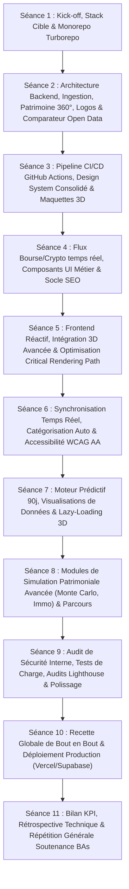

# 🗺️ Master Roadmap — Les 11 Séances YDays (Rythme B — Pathly V2)
## Cadrage Stratégique, Livrables & Déroulé Semestriel pour l'Équipe (8 Membres)

> **Projet :** Pathly V2 — Cockpit FinTech d'Intelligence Patrimoniale, Prédiction de Trésorerie & Optimisation de Dépenses  
> **Chef de Projet / Tech Lead :** Arthur COURCHAY  
> **Campus :** Rouen Ynov — Année 2026-2027  
> **Modèle de Développement :** 8 Développeurs assistés par Agents IA (Journées Complètes Intensives)

---

## 📅 Vue Synthétique des 11 Séances

---

## 📌 Détail des Séances

### Phase 1 : Fondation Architecturale & Socles Métier (Séances 1 à 3)

* **Séance 1 (Terminé) — Kick-off & Monorepo :**
  - Choix de la stack cible : Next.js 15, NestJS 11, Prisma, Supabase V2, Turborepo, pnpm workspaces.
  - Cadrage du backlog et attribution des 8 spécialités.

* **Séance 2 (En cours — Journée Intensive x3) — Architecture Temps Réel & Patrimoine 360° :**
  - Moteur **Safe-to-Spend en direct** (< 50ms) et calcul du Patrimoine Net global.
  - Moteur d'ingestion souverain multi-banques (OFX/CSV) + **Merchant Cleaner** et déduplication SHA-256.
  - **Comparateur d'économies d'énergie et télécoms 100% gratuit** basé sur l'Open Data français (Médiateur de l'Énergie, ARCEP).
  - Gestion patrimoniale complète : Biens physiques (montre, voiture, immo), Crédits & emprunts, Bourse avec PRU (PEA/CTO/Crypto), Projets de vie.
  - **Résolveur automatique de logos institutionnels** (CIC, Trade Republic, Binance, etc.).
  - **Financial Core 3D holographique réactif** à la santé financière + **Product Tour interactif** guidé ("qui claque").
  - Mises à jour optimistes (0ms) et Landing Page avec simulateur d'économies public.
  - Exigence des rapports techniques Markdown obligatoires avec le kit pour les slides PPTX d'Arthur.

* **Séance 3 — Pipeline CI/CD Robuste & Socle Design Finalisé :**
  - Industrialisation du workflow GitHub Actions (tests automatisés, builds distribués avec cache Turborepo distant).
  - Consolidation du Design System sur l'ensemble des pages (Dashboard, Patrimoine, Transactions, Simulations).
  - Finalisation des maquettes et des assets vectoriels haute résolution.

---

### Phase 2 : Enrichissement des Données & Moteurs Prédictifs (Séances 4 à 6)

* **Séance 4 — Flux Bourse & Crypto Temps Réel :**
  - Connexion aux flux de valorisation de marché (cotations actions/ETFs et cours crypto).
  - Calcul dynamique des plus/moins-values latentes et historiques.
  - Sécurisation avancée et isolation des secrets bancaires.

* **Séance 5 — Expérience Frontend Ultra-Fluide & Immersion 3D :**
  - Optimisation du Critical Rendering Path (FCP < 0.8s, CLS = 0).
  - Animations de transitions d'écrans Framer Motion sans re-render intempestif.
  - Intégration des graphiques financiers haute densité (Recharts / Visx customisés).

* **Séance 6 — Synchronisation Temps Réel & Catégorisation Intelligente :**
  - Système de catégorisation automatique auto-apprenant sur les libellés bancaires.
  - Gestion des règles personnalisées créées par l'utilisateur.
  - Audit complet d'accessibilité (contraste, focus clavier, lecteurs d'écran).

---

### Phase 3 : Intelligence Patrimoniale & Simulations Avancées (Séances 7 à 8)

* **Séance 7 — Moteur Prédictif de Trésorerie à 90 jours :**
  - Modélisation mathématique des variations saisonnières et des dépenses variables.
  - Détection prédictive des risques de trésorerie avec alertes proactives.
  - Optimisation du chargement des scènes 3D et des graphiques complexes.

* **Séance 8 — Simulateurs de Projets de Vie & Scénarios Patrimoniaux :**
  - Simulateur d'achat immobilier : calcul de capacité d'emprunt, taux d'usure, apport nécessaire et calendrier dynamique.
  - Simulation de retraite et liberté financière (méthode FIRE / règle des 4%).
  - Scénarios d'arbitrage de remboursement anticipé de crédits.

---

### Phase 4 : Hardening, Recette & Déploiement en Production (Séances 9 à 10)

* **Séance 9 — Audit de Sécurité, Tests de Charge & Polissage :**
  - Audit interne de sécurité (OWASP, protection injection, chiffrement au repos).
  - Tests de charge (K6 ou Artillery) sur l'API NestJS (< 100ms sous 500 requêtes/sec).
  - Traque impitoyable des régressions visuelles et sonores.
  - Validation Lighthouse 100% vert sur l'ensemble des pages.

* **Séance 10 — Recette Globale & Déploiement Production :**
  - Validation des parcours utilisateurs de bout en bout (End-to-End avec Playwright).
  - Déploiement de l'application sur Vercel (Web) et Supabase/Serveur dédié (API/BDD).
  - Configuration du nom de domaine, HTTPS et monitoring Sentry.

---

### Phase 5 : Clôture & Répétition Soutenance (Séance 11)

* **Séance 11 — Rétrospective, Bilan des KPI & Soutenance devant les Business Angels :**
  - Rétrospective technique globale de l'équipe de 8 développeurs.
  - Bilan des KPI atteints : performance (< 500ms), rétention SaaS, ROI utilisateur (+444 €/an d'économies).
  - Répétition générale de la présentation orale avec le support PowerPoint complet issu des rapports `.md`.
